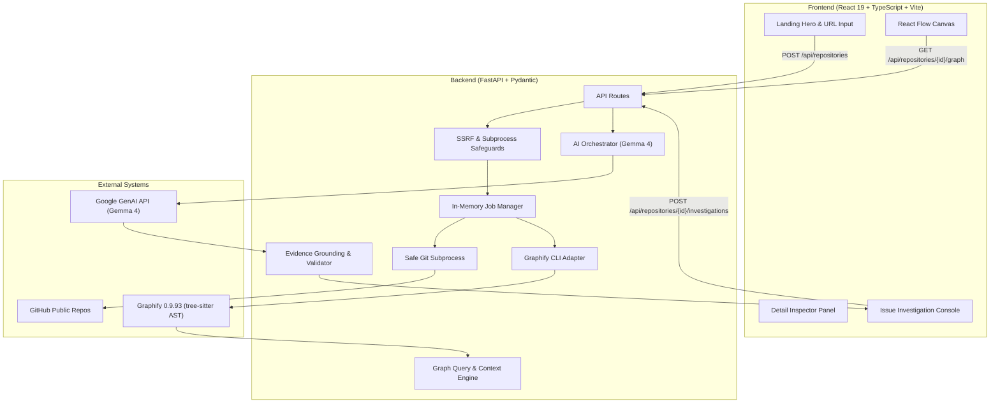

# OpenTrail

> **Navigate code. Trace impact. Contribute with confidence.**

OpenTrail turns supported public GitHub repositories into interactive maps of their internal code relationships. Developers can explore unfamiliar software, investigate bugs or feature requests, understand how relevant components connect, and generate an evidence-backed investigation and testing plan grounded in actual AST relationships.

---

## 1. Problem Statement
First-time open-source contributors and developers onboarding onto unfamiliar codebases face a wall of opacity:
- Reading endless files without understanding runtime and architectural connections.
- Guessing where a reported bug lives.
- Over-relying on generic AI chatbots that hallucinate functions, file paths, and fake relationships.

OpenTrail provides **issue-to-impact intelligence grounded in an actual repository graph**. It combines local tree-sitter AST extraction via **Graphify 0.9.93** with **Gemma 4** (`gemma-4-26b-a4b-it`) and a strict validation layer that cross-references recommendations against verified code entities.

---

## 2. Key Features

- **Public GitHub Ingestion**: Safely validates, canonicalizes, and performs single-branch shallow clones (`--depth 1`).
- **AST Relationship Extraction**: Employs Graphify 0.9.93 to extract classes, functions, methods, calls, imports, and cross-file bridges without executing untrusted repository code.
- **Neo-Brutalist Interactive Canvas**: Built with React Flow, styled with the locked neo-brutalist editorial design system (`#F7F3E8` Paper, `#222222` Ink, `#B8F56A` Electric Lime, `#789BFF` Cobalt Blue, `#FF8A65` Coral).
- **Symbol & File Inspection**: Detailed inspector panel displaying line locations, incoming callers, outgoing calls, degree metrics, and downstream impact analysis.
- **Grounded Issue Investigation**: Submit issue descriptions or bug reports to receive structured recommendations from Gemma 4. Hallucinated entities are strictly filtered out by the validation engine.
- **Shortest Path & Impact Tracing**: Trace verified call chains between any two components and highlight downstream consumers before making a breaking change.
- **Offline / Zero-Key Support**: Works out of the box even without an AI API key, utilizing deterministic AST graph grounding.

---

## 3. Architecture



---

## 4. Technology Stack

- **Frontend**: React 19, TypeScript, Vite, `@xyflow/react` (React Flow), `lucide-react`, Vanilla CSS Neo-Brutalist Design System.
- **Backend**: Python 3.14 / 3.11, FastAPI, Pydantic v2, Uvicorn, HTTPX, Pytest.
- **Code Graph Extraction**: Graphify 0.9.93 (`graphify extract --code-only`, `path`, `affected`).
- **AI / LLM**: Gemma 4 (`gemma-4-26b-a4b-it` / `gemma-4-31b-it`) via the `google-genai` SDK, with fallback support and offline deterministic grounding.

---

## 5. Prerequisites

- **Python**: 3.11+ (Python 3.14 confirmed working on Windows).
- **Node.js**: v20+ (Node v24.22.0 confirmed working).
- **Git**: Installed and accessible on `PATH`.
- **Graphify**: `graphifyy 0.9.93` installed in the target Python environment.

---

## 6. Installation & Local Development

### 1. Clone the repository
```bash
git clone https://github.com/opentrail/opentrail.git
cd opentrail
```

### 2. Configure Environment
Copy the example environment file:
```bash
cp .env.example .env
```
Key settings:
- `PYTHON_EXECUTABLE`: Path to Python with Graphify (e.g. `D:\python.exe` or `python`).
- `GEMINI_API_KEY`: *(Optional)* Your Google Gen AI API key for Gemma 4. Leave empty to use offline graph grounding.
- `GEMMA_MODEL`: `gemma-4-26b-a4b-it` (default) or `gemma-4-31b-it`.

### 3. Backend Setup
```bash
# Install backend dependencies
pip install -r backend/requirements.txt

# Start backend server
python -m uvicorn backend.app.main:app --host 127.0.0.1 --port 8000 --reload
```
The backend API documentation is available at `http://127.0.0.1:8000/docs`.

### 4. Frontend Setup
In a new terminal:
```bash
cd frontend
npm install
npm run dev
```
Open `http://localhost:5173` in your browser.

---

## 7. Running Tests

### Backend Unit & Integration Tests (16 tests)
```bash
python -m pytest backend/tests -v
```
Verifies:
- URL validation, SSRF protection, and path traversal defense (`test_security.py`).
- Graphify AST extraction and fixture normalization (`test_graphify_adapter.py`).
- Gemma 4 bounded context construction & evidence validation (`test_ai_orchestrator.py`).
- All REST endpoints (`test_api.py`).

### Frontend Production Build Check
```bash
cd frontend
npm run build
```
Ensures zero TypeScript compiler errors and produces an optimized production bundle.

### End-to-End Live Verification
```bash
python backend/tests/verify_live.py
python backend/tests/test_real_repo.py
```

---

## 8. Security & Threat Model

OpenTrail enforces strict boundaries:
- **SSRF Defense**: Restricts repository URLs strictly to `https://github.com/{owner}/{repo}`. Rejects all IP literals, non-HTTPS protocols, alternate hosts, credentials, and path traversal sequences.
- **Zero Shell Invocation**: All Git and Graphify commands execute with parameterized argument arrays (`shell=False`).
- **Safe Static Extraction**: Graphify runs in `--code-only` mode (AST tree-sitter parsing). No user repository code, build scripts (`npm install`, `make`), or test runners are ever executed.
- **Workspace Containment**: Shallow clones occur in isolated temporary workspaces with automatic cleanup.
- **Prompt Injection Boundaries**: Repository files and issues are treated as untrusted strings wrapped in clear XML boundaries.
- **Evidence Validation**: LLM outputs are cross-checked against actual AST nodes to prevent hallucinated references.

See [`docs/SECURITY.md`](docs/SECURITY.md) for full details.

---

## 9. Demonstration Workflow

1. Open `http://localhost:5173`.
2. Click **★ Preloaded Demo (opentrail/sample)** for instant exploration of the built-in test repository, or paste a public repo such as `https://github.com/bottlepy/bottle`.
3. Observe the 5-stage progress bar: Validating -> Fetching -> Extracting -> Preparing -> Ready.
4. In the workspace, explore the React Flow canvas with Neo-brutalist nodes.
5. Click on `MetricProcessor` (or `Bottle`) to inspect its source location, line numbers, and callers in the Detail Panel.
6. Click **Investigate Issue** in the left sidebar, paste a bug report (e.g. *"Route decorator fails to bind handler in Bottle"*), and click **Investigate Impact**.
7. Review the verified components, suggested tests, and next steps.
8. Click **Highlight All on Canvas** to trace the affected components directly on the graph.

---

## 10. License

Released under the [MIT License](LICENSE).
