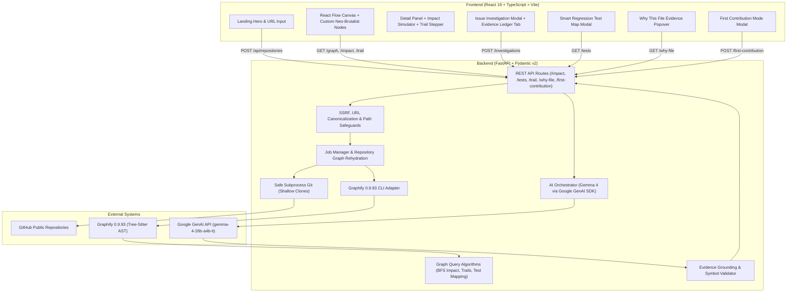

# OPENTRAIL

> **Navigate code. Trace impact. Contribute with confidence.**

OpenTrail turns public GitHub repositories into interactive maps of code relationships and uses graph-grounded AI intelligence to help developers understand unfamiliar repositories, estimate change impact, inspect evidence, identify regression tests, and make contributions with confidence.

Its core principle: **Every recommendation must be traceable to repository evidence, and the interface must help developers explore that evidence themselves.**

---

## 1. Product Capabilities & The Six Differentiators

OpenTrail is engineered as an **evidence-first code intelligence platform**, going far beyond generic AI chatbots:

### 1. Evidence Ledger (Feature One)
- Every AI finding or recommendation contains inspectable proof: repository-relative file paths, verified symbol names, exact line numbers/ranges, source excerpts, and connecting graph edges.
- Explicit evidence classifications:
  - **Verified in source**: Confirmed on disk in the analyzed repository.
  - **Graph-supported**: Present as an extracted AST relationship.
  - **AI hypothesis**: Inferred explanation not yet proven by structural edges.
  - **Proposed recommendation**: Suggested change or test not yet executed.
- Transparently highlights what remains uncertain or unverified.

### 2. Change Impact Simulator (Feature Two)
- Select any function, method, or class and click **Simulate Change Impact**.
- Computes bounded AST traversal across callers, consumers, and dependencies.
- Segregates **Direct Impact (1-hop)** from **Transitive Impact (>1-hop)**.
- Displays exact causal paths (e.g., `main()` → `MetricProcessor` → `calculate_metrics()`).
- Identifies candidate regression tests connected to the affected path.
- Renders dual-color highlighting on the React Flow canvas (coral for direct, amber for transitive).

### 3. Smart Regression Test Map (Feature Three)
- Discovers tests actually present in the repository from AST nodes and test suites.
- Computes transparent relevance rankings (0–100%) based on AST call distance to the target symbol.
- Strictly enforces verified test states:
  - `Existing test — verified` (present in repository code)
  - `Proposed new test` (generated recommendation; not on disk)
  - `Suggested manual validation`
- Never claims execution success without an authorized test run.

### 4. Interactive Execution Trail (Feature Four)
- Guided step-by-step dependency traversal through the codebase.
- Floating Neo-Brutalist stepper bar allows walking through hops: Step 1 → Step 2 → Step 3.
- Highlights the current hop in electric lime and previous hops in cobalt, dimming unrelated nodes.
- Exposes source excerpts, line numbers, incoming relationship types, and provenance (`Extracted AST Edge` vs `Model Inferred`).

### 5. First Contribution Mode (Feature Five)
- Dedicated onboarding workflow for newcomers tackling an unfamiliar repository or issue.
- Produces:
  1. **Plain-English Orientation**: Clear summary without internal jargon.
  2. **Recommended File Reading Order**: Numbered sequence with "Why this file?" triggers.
  3. **Key Architectural Roles**: Plain-language explanations of core classes and functions.
  4. **Step-by-Step Checklist**: Actionable steps with "Focus in Graph" triggers.
  5. **Regression Test Targets**: Guidance on which test suites to inspect.

### 6. "Why this file?" Explanations (Feature Six)
- Clickable evidence breakdown on any recommended file across investigations, impact analyses, and contribution plans.
- Explains:
  - Which parts of the task matched the file.
  - Which verified AST symbols live in the file.
  - Which connecting graph edges link it to the rest of the investigation.
  - Whether the file is a direct match, transitive neighbor, or inferred candidate.
  - What caveats or missing evidence remain.

---

## 2. Architecture



---

## 3. Technology Stack & Identity

### Design System & Visual Identity
- **Design style**: Neo-brutalist editorial typography and high-contrast paper panels.
- **Color Palette**:
  - Paper Background: `#F7F3E8`
  - Ink: `#222222`
  - Electric Lime: `#B8F56A` (Primary actions, highlights, verified badges)
  - Cobalt Blue: `#789BFF` (Classes, trails, graph connections)
  - Coral: `#FF8A65` (Tests, direct impact, architectural hubs)

### Frontend
- **Framework**: React 19 + TypeScript + Vite
- **Graph Canvas**: `@xyflow/react` (React Flow)
- **Icons**: `lucide-react`
- **Styling**: Vanilla CSS tokens in `src/index.css`

### Backend
- **Framework**: Python 3.11+ / 3.14, FastAPI, Pydantic v2, Uvicorn
- **Static Code Analysis**: Graphify 0.9.93 (Tree-Sitter AST parser)
- **AI Engine**: Google GenAI SDK with Gemma 4 (`gemma-4-26b-a4b-it`) and fallback to deterministic AST graph grounding

---

## 4. Local Installation & Development

### 1. Prerequisites
- **Python**: 3.11+ (Python 3.14 verified)
- **Node.js**: v20+ (Node v24.22.0 verified)
- **Git**: Accessible on command line
- **Graphify**: Installed in your Python environment (`& "D:\python.exe" -m graphify --help`)

### 2. Configure Environment
Create `.env` from `.env.example`:
```bash
cp .env.example .env
```
Key variables:
```ini
# Python Executable with Graphify
PYTHON_EXECUTABLE=D:\python.exe

# Google GenAI / Gemma 4 Credentials (Optional: leaves empty for deterministic offline AST mode)
GEMINI_API_KEY=your_key_here
GEMMA_MODEL=gemma-4-26b-a4b-it
FALLBACK_MODEL=gemini-3.8-flash

# Frontend URL
FRONTEND_ORIGIN=http://localhost:5173
```

### 3. Start Backend API Server
```bash
# In project root:
& "D:\python.exe" -m uvicorn backend.app.main:app --host 127.0.0.1 --port 8000 --reload
```
API documentation available at `http://127.0.0.1:8000/docs`.

### 4. Start Frontend Development Server
```bash
cd frontend
npm install
npm run dev
```
Open `http://localhost:5173` in your browser.

---

## 5. Verification & Automated Tests

### Run Full Backend Test Suite
```bash
& "D:\python.exe" -m pytest backend/tests -v
```
Test suite coverage:
- Configuration loading, `.env` search, and secret protection (`test_config_and_ai_detection.py`)
- SSRF prevention, HTTPS validation, and path traversal defense (`test_security.py`)
- Graphify AST extraction and fixture normalization (`test_graphify_adapter.py`)
- Grounding audit, hallucinated entity rejection, and test status verification (`test_audit_investigation.py`)
- REST API endpoints for graph, impact, tests, trail, why-file, and first-contribution (`test_api.py`)
- Real end-to-end repository exploration against Bottle (`test_real_repo.py`, `test_real_repo_issue.py`)

### Run Frontend Production Build
```bash
cd frontend
npm run build
```
Validates zero TypeScript errors and compiles the optimized production bundle (`dist/`).

---

## 6. Demonstration Workflow

1. Open `http://localhost:5173`.
2. Click **Demo Sample** in the top navigation bar (or paste any public repository such as `https://github.com/bottlepy/bottle`).
3. **Graph Exploration**:
   - Filter by kind (`class`, `function`, `test`, `file`) or relationship (`calls`, `imports`, `contains`).
   - Click any node (e.g., `calculate_metrics` or `MetricProcessor`).
4. **Change Impact Simulation**:
   - In the Detail Panel on the right, select Depth (1, 2, or 3 hops) and click **Simulate**.
   - Observe direct callers highlighted in coral, transitive dependencies in amber, and affected graph edges illuminated.
5. **Interactive Execution Trail**:
   - Click **Trace Trail** in the Detail Panel.
   - Use the floating stepper bar to step through the dependency chain hop-by-hop.
   - Click "View Source" on any step to inspect the source excerpt.
6. **Smart Regression Test Map**:
   - Click **Test Map** in the top navigation.
   - Inspect verified existing tests vs. proposed tests with relevance ranking scores and connecting AST paths.
7. **First Contribution Mode**:
   - Click **First Contribution** in the top navigation or sidebar.
   - Enter a task description and click **Generate Contribution Guide**.
   - Walk through the reading order, component explanations, and checklist steps.
8. **Issue Investigation & Evidence Ledger**:
   - Click **Investigate Issue** in the left sidebar.
   - Enter a bug description (e.g., *"MetricProcessor calculation fails with empty list"*).
   - Click **Investigate Grounded Impact**.
   - Switch between **Investigation Overview**, **Evidence Ledger** (inspecting classifications and line ranges), and **Regression Tests**.
   - Click **Why this file?** on any file to inspect matched terms, AST symbols, and caveats.

---

## 7. Security & Safeguards

- **Strict URL Whitelisting**: Only `https://github.com/{owner}/{repo}` URLs are accepted. IP literals, internal hosts, credentials, and alternative protocols are rejected.
- **Process Isolation**: All subcommands (Git, Graphify) execute with argument arrays (`shell=False`). No repository build scripts, package managers, or test runners are executed automatically.
- **Secret Protection**: API keys remain strictly on the backend. Client payloads, error messages, and debug logs sanitize secrets automatically.
- **Safe Static Extraction**: Graphify runs in `--code-only` mode, relying exclusively on Tree-Sitter AST grammar parsing without runtime code execution.

---

## 8. Honest Limitations & Caveats

- **Static Analysis Bounds**: OpenTrail traces AST relationships. It does not claim complete runtime execution coverage; dynamic reflection, monkey patching, runtime `eval`, and dynamic imports may not be reflected in static graphs.
- **Test States**: Finding a test symbol in the AST confirms its existence, not that it passed. Test execution states are only shown when an authorized test run was recorded.
- **Supported Languages**: Primary AST extraction is supported for Python, JavaScript, and TypeScript via Graphify 0.9.93.

---

## 9. License

Released under the [MIT License](LICENSE).
