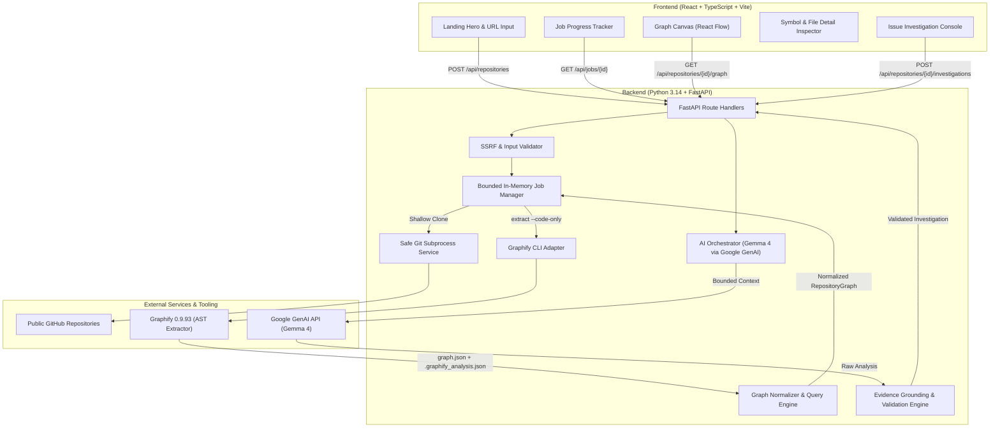

# OpenTrail — Architecture Specification

## 1. Executive Summary

OpenTrail is an open-source codebase intelligence engine designed for developers exploring unfamiliar software, students onboarding to open source, and maintainers debugging complex issue reports.

Unlike generic chatbot interfaces or passive code search engines, OpenTrail grounds all software understanding in an extracted AST-level relationship graph generated by **Graphify 0.9.93**, paired with **Gemma 4** (`gemma-4-26b-a4b-it` / `gemma-4-31b-it`) for contextual reasoning, and a verification layer that eliminates hallucinated references.

---

## 2. High-Level System Architecture

---

## 3. Core Subsystems

### 3.1 Backend Architecture

1. **Security & Input Validator (`app.core.security`)**:
   - Canonicalizes GitHub URLs.
   - Enforces HTTPS scheme, rejects IP literals, localhost, RFC1918 private subnets, cloud metadata IPs, and embedded credentials.
   - Restricts repository paths to alphanumeric ASCII characters and approved symbols (`-`, `_`, `.`).

2. **Git Subprocess Service (`app.core.git_service`)**:
   - Executes shallow clones (`git clone --depth 1 --no-tags --single-branch`).
   - Uses parameterized argument arrays (`list[str]`), strictly avoiding shell string evaluation (`shell=False`).
   - Applies strict timeouts (e.g. 60s) and repository size/file count guards.

3. **Graphify Adapter (`app.core.graphify_adapter`)**:
   - Integrates with Graphify 0.9.93 via `D:\python.exe -m graphify extract <dir> --code-only`.
   - Ingests raw outputs:
     - `graphify-out/graph.json` (nodes, links, locations, callable metadata).
     - `graphify-out/.graphify_analysis.json` (communities, god nodes, surprises, cohesion).
   - Can invoke auxiliary subcommands:
     - `graphify affected <node> --graph <path>` (reverse traversal).
     - `graphify path <source> <target> --graph <path>` (shortest path).
     - `graphify export html` (fallback export).

4. **Canonical Graph Normalizer & Engine (`app.core.graph_query`)**:
   - Translates raw Graphify schemas into strongly typed Pydantic models:
     - `GraphNode`: `id`, `label`, `kind` (`file`, `class`, `function`, `method`, `module`), `file_path`, `symbol_name`, `line_start`, `line_end`, `community`, `degree`, `is_hub`.
     - `GraphEdge`: `id`, `source`, `target`, `relation` (`calls`, `imports`, `contains`, `method`, `references`), `confidence` (`EXTRACTED` vs `INFERRED`), `confidence_score`, `source_file`, `source_location`.
     - `RepositoryGraph`: normalized nodes, edges, hub nodes, cross-file surprises, and metric summary.
   - Rejects dangling references and self-referencing anomalies.

5. **AI Orchestrator & Evidence Grounding (`app.core.ai_orchestrator`)**:
   - Uses official Google Gen AI SDK (`google-genai`).
   - Targets Gemma 4 (`gemma-4-26b-a4b-it` / `gemma-4-31b-it`).
   - Constructs a bounded contextual representation of the repository (hub components, relevant files, candidate symbols).
   - Strict prompt engineering treating code as data to prevent prompt injection.
   - **Validation Layer**: Matches every returned component against actual nodes in the canonical graph. Hallucinated files, symbols, or invalid relationships are flagged or excised.

6. **Job Manager (`app.core.job_manager`)**:
   - Tracks asynchronous analysis states (`queued` -> `fetching` -> `extracting` -> `ready` | `failed`).
   - Thread-safe storage with TTL cleanup of temporary clone workspaces.

---

### 3.2 Frontend Architecture

1. **Tech Stack**:
   - React 19 + TypeScript + Vite.
   - Canvas: `@xyflow/react` (React Flow) for 2D relationship mapping.
   - Icons: `lucide-react`.
   - Styling: Neo-brutalist editorial design system in Vanilla CSS.

2. **Design Tokens**:
   - Canvas Paper: `#F7F3E8`
   - Near-Black Ink: `#222222`
   - Electric Lime (Primary / Path Highlights): `#B8F56A`
   - Cobalt Blue (Nodes / Selections): `#789BFF`
   - Coral (Inspection / Alerts): `#FF8A65`
   - Typography: Clean monospace + high-contrast sans serif.
   - Borders: `2px solid #222222` with solid offset shadows (`3px 3px 0 #222222`).

3. **Key Components**:
   - `LandingHero`: Repository input, benefit callouts, and interactive example preview.
   - `ProcessingStatus`: Live stage progress tracker (`Validating` -> `Fetching` -> `Extracting` -> `Ready`).
   - `GraphCanvas`: Custom node renderer with category badges (`class`, `function`, `file`), edge styling by confidence (`EXTRACTED` vs `INFERRED`), zoom/pan controls, search, and category filters.
   - `DetailPanel`: Context inspector showing selected node source location, incoming/outgoing relationships, and community membership.
   - `IssueInvestigation`: Modal/drawer to submit issue descriptions, view structured recommendations, and highlight verified investigation paths directly on the graph.
